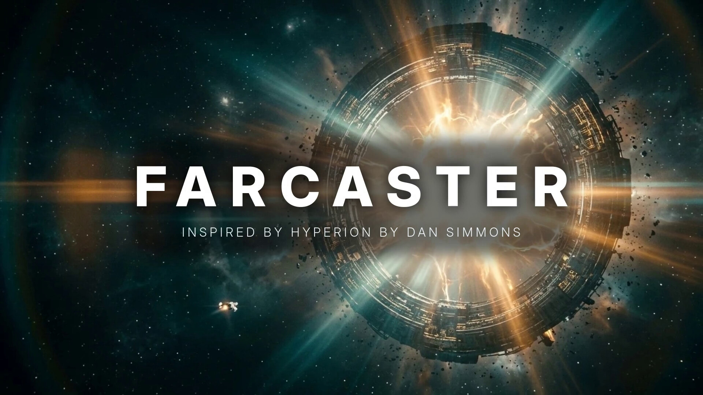

# FARCASTER — a fan-made concept trailer (poidh bounty base/1093)

**Video (67 s, 1920×1080):** [farcaster_trailer.mp4](farcaster_trailer.mp4)

A one-minute sci-fi trailer for "Farcaster", inspired by Dan Simmons' *Hyperion*: a web of a hundred worlds joined by
portal gates, a step between planets, treeships, the time tombs, and the night the gates begin to fail. It doubles as a
pitch for Farcaster the protocol: one step, any world.

| # | Scene | Card |
|---|---|---|
| 1 | Ring farcaster gate orbiting a gas giant | IN A WEB OF A HUNDRED WORLDS |
| 2 | City street where every doorway opens onto another planet | EVERY DOOR OPENED ONTO ANOTHER SKY |
| 3 | A traveler steps from desert into a forest of giant trees | ONE STEP WAS ENOUGH |
| 4 | A living treeship sailing through space | |
| 5 | The portal network as a web of light | THEY CALLED IT THE FARCASTER NETWORK |
| 6 | Crystal tombs in a storm, time flowing backwards | BUT SOMETHING WAITS AT THE EDGE OF TIME |
| 7 | Pilgrims crossing red sand toward a monolith | |
| 8 | A gate collapsing in a city plaza | WHEN THE GATES FAIL |
| 9 | A pilgrim looks back, lit by an open portal | WHERE WILL YOU STEP NEXT? |
| 10 | The great gate opens | FARCASTER — inspired by Hyperion by Dan Simmons |

**How it was made.** The ten stills (`scenes/`) were generated with Google Flow (AI image model) from my own prompts.
Motion (slow push-ins), crossfades, title cards and sound design were done locally with ffmpeg and ImageMagick
(`build_trailer.sh`); sound effects are from Mixkit (free licence) over a synthesized drone. No footage, music or
artwork from the book, any film or any other creator was used.

Fan-made and unofficial: not affiliated with Dan Simmons, his publishers or Farcaster.
