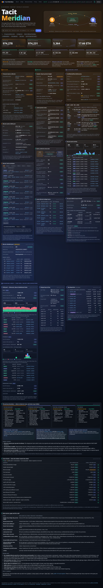

# Tacit Meridian — a one-page Tacit explorer (poidh bounty base/1519)

**Live:** https://qlufiq-collab.github.io/bounty-submissions/poidh-1519-tacit-explorer/

One static page that shows the whole Tacit system side by side: Bitcoin envelopes and the Bitcoin-native AMM, the bridge (header relay, proven roots, burns, mints and cross-outs), the Ethereum ConfidentialPool and its assets, and the EVM pool on Ethereum, Base and Robinhood Chain. A privacy panel shows what an observer can see and what stays hidden, and a lookup box takes a tacit1 ID, a Bitcoin txid or address, an EVM address or tx, or an XNS name (`alice@xns`).

- **Real mainnet data, read by your browser.** Sources: Tacit's public indexer (`api.tacit.finance`), the Bitcoin shielded-pool indexer, mempool.space, and public Ethereum / Base / Robinhood Chain RPCs. Every number carries a chip saying where it came from.
- **Cross-checks.** A card compares the indexer with the chain (15 quantities at the last audit: 15 exact, 0 mismatched).
- **No wallet, no keys, no backend, no cookies.** Strict CSP, no third-party scripts or fonts.
- **XNS bonus.** Depositor addresses are shown as XNS names where one exists, and lookup resolves `name@xns`.

Code: plain HTML/CSS/JS in this folder, no build step. Serve the folder with any static server to run it locally. `NOTES.md` lists the endpoint for every panel, known gaps, and the final audit.

Protocol: https://github.com/src-company/tacit · Built with an AI coding assistant ("vibecoded").

